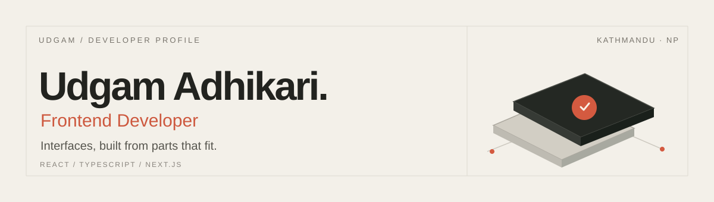

 

**Frontend Developer · React & Next.js · UI Engineering**

I build responsive interfaces, reusable components, and the connections that make them work.

 

---

### 01 / About me

I'm **Udgam**, a frontend developer based in **Kathmandu, Nepal**. I've been working professionally since **July 2024**, building web interfaces and the components and API integrations behind them.

I care about clear layouts, maintainable code, accessibility, and the little details that make an interface feel effortless. I enjoy working across the stack when a project needs it, but frontend engineering is where I spend most of my time.

- Building with **React, Next.js, TypeScript**, and modern CSS.
- Connecting interfaces to **REST APIs**, backend services, and databases.
- Improving **responsiveness, performance, and usability** across devices.
- Exploring thoughtful **motion and interactive 3D** for the web.

---

### 02 / The toolkit

**Frontend & interface development**

**Backend & databases**

**Tools & deployment**

**Also in my workflow:** shadcn/ui · Zustand · npm · API testing

### 05 / GitHub activity
<h3 align="center">GITHUB ACTIVITY</h3>

  Building consistently. Improving every day.

  

---

**Have an interface to build or improve?**

[Explore my work](https://www.udgamadhikari.com.np/) · [Send me an email](mailto:udgamadhikari26@gmail.com) · [See my repositories](https://github.com/UdgamAdhikari?tab=repositories)

Kathmandu, Nepal · Built with curiosity and attention to detail.

