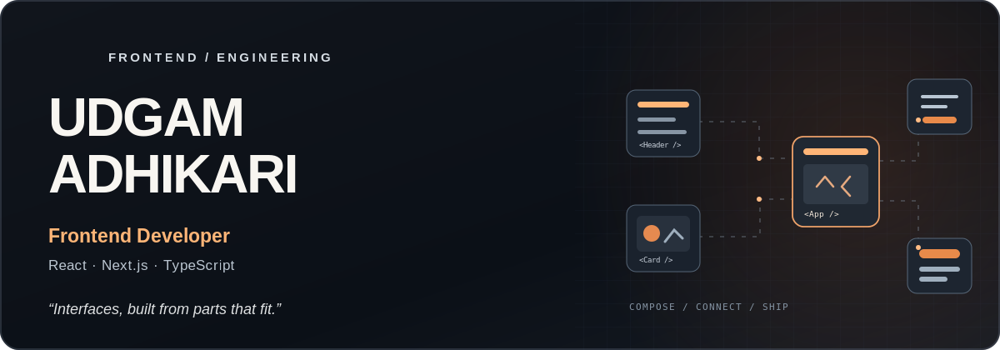

  

<h3 align="center">Thoughtful interfaces. Reusable systems.</h3>

  Frontend developer based in Kathmandu, Nepal. 
  Building responsive experiences, reusable components, and the integrations behind them.

  <a href="https://www.udgamadhikari.com.np/">Portfolio</a>
  &nbsp;&nbsp;·&nbsp;&nbsp;
  <a href="https://github.com/UdgamAdhikari">GitHub</a>
  &nbsp;&nbsp;·&nbsp;&nbsp;
  <a href="https://www.linkedin.com/in/udgam-adhikari-6412b8321/">LinkedIn</a>
  &nbsp;&nbsp;·&nbsp;&nbsp;
  <a href="mailto:udgamadhikari26@gmail.com">Email</a>

<h2>01 — About</h2>

  I'm <strong>Udgam Adhikari</strong>, a frontend developer working professionally since
  <strong>July 2024</strong>. I build web interfaces and the components and API integrations behind them.

  I care about clear layouts, maintainable code, accessibility, and the small details that make an interface
  feel effortless. I enjoy working across the stack when a project needs it, but frontend engineering is
  where I spend most of my time.

  My focus includes responsive React, Next.js and TypeScript interfaces; REST APIs, backend services and
  databases; performance and usability across devices; and exploring thoughtful motion and interactive 3D
  on the web.

<h2>02 — Toolkit</h2>

<h3>Frontend &amp; UI Engineering</h3>

  

HTML · CSS · JavaScript · TypeScript · React · Next.js · Tailwind CSS

<h3>Backend &amp; Databases</h3>

  

Node.js · Express · PostgreSQL · MongoDB

<h3>Development Tools &amp; Deployment</h3>

  

Git · GitHub · Docker · Postman · Vercel · Linux

<h3>Additional Workflow Tools</h3>

  <code>shadcn/ui</code>
  &nbsp;
  <code>Zustand</code>
  &nbsp;
  <code>npm</code>
  &nbsp;
  <code>API testing</code>

<h2>03 — GitHub Activity</h2>

  

  Live statistics are provided by an external service and may occasionally be unavailable.

<h2>04 — Get in Touch</h2>

  Have an interface to build or improve? Explore my
  <a href="https://www.udgamadhikari.com.np/">portfolio</a>,
  <a href="https://github.com/UdgamAdhikari?tab=repositories">browse my repositories</a>,
  or <a href="mailto:udgamadhikari26@gmail.com">send me an email</a>.

  Kathmandu, Nepal · Interfaces, built from parts that fit.

